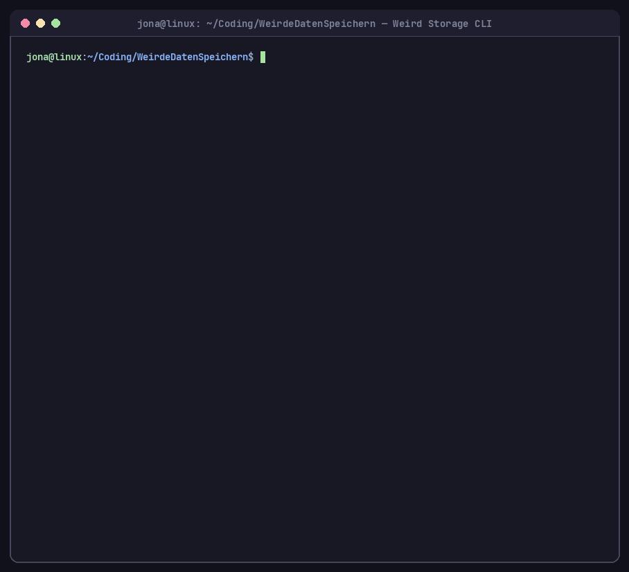

# Weird Storage: Volatile CPU-Cache Timing Storage (Flush+Reload)

> *"Storing files in RAM is way too easy, so I abused CPU cache lines, clflush, and cycle-accurate rdtscp timing to build the most cursed, volatile storage engine that technically shouldn't exist."*

Ein vollständiges Low-Level-C11-Projekt und universelles **CLI-Tool** für **Linux x86_64**, das beliebige Dateien (PNG, GIF, JPEG, PDF, ELF-Binaries, ZIP/GZIP-Archive, Audio, Quellcode, Roh-Binärdaten) oder Strings weder auf einer Festplatte noch als reguläre Variablen im Arbeitsspeicher (DRAM) ablegt, sondern **ausschließlich im mikroarchitektonischen Zustand der CPU-Cache-Hierarchie (L1d / L2 / LLC)** kodiert und selbst **prozessübergreifend nach dem Schließen des Programms** wiederherstellt.



---

## 🔥 Highlight: Programm schließen & später aus dem CPU-Cache laden (`store` / `load`)

Über geteilte physische Null-Seiten (`/dev/shm/weird_cache_arena`, die im RAM zu **100% aus `0x00`-Bytes** bestehen!) und einen abgekoppelten Hintergrund-Keeper-Daemon (`setsid`) kannst du eine Datei oder Nachricht in den CPU-Cache legen, **das Programm (oder dein Terminal) komplett schließen** und die Daten später in einem völlig neuen Prozess allein durch `__rdtscp`-Latenzmessung wiederherstellen:

```bash
# 1. Beliebige Datei (z. B. Bild, Binary, PDF) oder Text in den CPU-Cache legen & Programm beenden:
./cache_storage store geheim.png

# 2. Forensik-Beweis: Die gemappte Arena enthält im RAM ausschließlich Nullen (0x00)!
hexdump -C /dev/shm/weird_cache_arena
# -> 00000000  00 00 00 00 00 00 00 00  00 00 00 00 00 00 00 00  |................|

# 3. Live-Status des Hintergrund-Cache-Keeper-Daemons abfragen:
./cache_storage status

# 4. Später in einem komplett neuen Prozess wieder aus den CPU-Cache-Lines rekonstruieren:
./cache_storage load -o wiederhergestellt.png
cmp geheim.png wiederhergestellt.png

# 5. Cache-Lines aktiv via _mm_clflush invalidieren & Daten endgültig im Nichts verpuffen lassen:
./cache_storage purge
```

---

## 🧬 Wie es funktioniert (Microarchitektur-Topologie)

Anstatt Bytes in den Arbeitsspeicher zu schreiben, nutzt diese Engine eine **Flush+Reload-Topologie** auf einer mit `0x00` genullten `mmap`-Speicher-Arena. Ein Speicher-Dump des physischen RAMs der Arena zeigt zu jedem Zeitpunkt ausschließlich Nullen.

```text
   Binärdatei / Bitstrom:  [ 1 ]         [ 0 ]         [ 1 ]         [ 0 ]
                             │             │             │             │
                             ▼             ▼             ▼             ▼
┌─────────────────────────────────────────────────────────────────────────┐
│ Geteilte mmap-Arena (DRAM-Inhalt überall 0x00, Stride = 256 Bytes)      │
│  Slot #0 (+0x000)   Slot #1 (+0x100)   Slot #2 (+0x200)   Slot #3       │
└─────────┬──────────────────┬──────────────────┬──────────────────┬──────┘
          │ Load (*addr)     │ _mm_clflush()    │ Load (*addr)     │ _mm_clflush()
          ▼                  ▼                  ▼                  ▼
┌───────────────────┐ ┌──────────────┐ ┌───────────────────┐ ┌──────────────┐
│   L1d / L2 Cache  │ │ DRAM (Evict) │ │   L1d / L2 Cache  │ │ DRAM (Evict) │
│   Hit (~40-90 c)  │ │ Miss (>200c) │ │   Hit (~40-90 c)  │ │ Miss (>200c) │
└───────────────────┘ └──────────────┘ └───────────────────┘ └──────────────┘
```

### 1. Cache-Line-Mapping & Page-Interleaved Probing (`STRIDE = 256`)
Jedes Bit `i` eines Frames wird auf eine eigene Speicheradresse `arena + i * STRIDE` gemappt:
- **Spatial Prefetcher Mitigation:** Moderne x86-Prozessoren besitzen einen *Adjacent Cache Line Prefetcher*, der zwei benachbarte 64-Byte-Cache-Lines zu einem 128-Byte-Sektor koppelt. Durch `STRIDE = 256` (4 Cache-Lines Abstand) wird ein direktes räumliches Übersprechen benachbarter Bits verhindert.
- **Zweistufiger Refresh (Pass 1 Load / Pass 2 Flush):** Um auch den *L1/L2 Streamer Prefetcher* innerhalb einer 4-KB-Speicherseite auszuhebeln, lädt die Engine zuerst alle `1`-Bits in den Cache, serialisiert die Pipeline (`_mm_mfence`) und verdrängt anschließend gezielt alle `0`-Bits via `_mm_clflush`.
- **Page-Interleaved Probing (4096-Byte-Sprünge beim Lesen):** Der Reader tastet die Bits mit einer Schrittweite von 16 Slots (`16 * 256 = 4096 Bytes = 1 Page`) ab, sodass pro Refresh-Epoche niemals zwei Slots innerhalb derselben 4-KB-Speicherseite gemessen werden. Da Hardware-Prefetcher keine 4-KB-Seitengrenzen überschreiten, wird Lese-Prefetching zu 100% eliminiert.

### 2. Multi-Frame L1/L2-Streaming für beliebige Dateiformate (`CACHE_FRAME_BYTES = 32`)
Da der private L1d-Cache (32 KB, 8-Wege-assoziativ) nur eine begrenzte Anzahl an Cache-Lines im selben Cache-Set konfliktfrei halten kann, verarbeitet die Engine beliebig große Binärdateien automatisch in **L1-residenten Frames zu je 32 Bytes (256 Bits)**:
- **100% Binärsicher (`0x00`-fähig):** Dateien werden über exakte Byte-Längen (`fread` / `stat`) verarbeitet – Null-Bytes mitten in Bildern, PDFs, ZIP-Archiven oder ELF-Executables bleiben bitgenau erhalten.
- **Automatische Magic-Byte-Erkennung:** Erkennt Dateiformate automatisch anhand ihrer Binär-Signatur (PNG, GIF, JPEG, WebP, BMP, PDF, ELF, ZIP, GZIP, XZ, ZSTD, WAV, FLAC, MP3, Ogg, SQLite3, WASM, Text/Code u. v. m.).
- **64-Bit FNV-1a Integritätsnachweis:** Berechnet vor und nach der Cache-Rekonstruktion einen 64-Bit FNV-1a Hash über alle Bytes und vergleicht zusätzlich jedes einzelne Bit.

### 3. Zyklengenaue Rekonstruktion (`__rdtscp`) & Majority Voting
Beim Auslesen (`decode_from_cache`) wird die Zugriffslatenz jeder Bit-Adresse mit dem Time-Stamp-Counter (`__rdtscp`) und strikten Serialisierungsbarrieren (`_mm_mfence`, `_mm_lfence`) gemessen:
1. Vor jedem Lauf kalibriert `calibrate_cache_timing()` dynamisch den **Median** aus **1000 Hit-** und **1000 Miss-Messungen**, um den exakten Schwellenwert (`threshold`) der aktuellen CPU zu bestimmen.
2. Für jedes Bit werden standardmäßig **5 Messrunden (Majority Voting)** durchgeführt, um transiente Ausreißer durch OS-Jitter oder Hardware-Interrupts herauszufiltern.
3. Wird bei einer Messung ein Cache-Miss (`Bit 0`) detektiert, hat der Messzugriff selbst die Cache-Line soeben in den L1-Cache geladen – der Reader führt daher unmittelbar wieder `_mm_clflush` aus (*Destructive Read Recovery*).

---

## 🛠 Systemvoraussetzungen

- **Betriebssystem:** Linux (`x86_64`)
- **Prozessor:** Intel oder AMD x86_64 CPU mit Unterstützung für `clflush` und `rdtscp`
- **Build-Tools:** `gcc` (mit C11- und `x86intrin.h`-Support), `make`, `pthread`

---

## 🚀 Build & CLI-Referenz

### 1. Kompilieren und All-in-One Demo starten
```bash
make run
```

### 2. CLI-Befehle & Optionen

```bash
./cache_storage [BEFEHL] [OPTIONEN] [DATEI_ODER_TEXT]
```

#### Befehle (Modi)
| Befehl | Beschreibung |
| :--- | :--- |
| `store <datei\|text>` | Lädt beliebige Datei oder Text in den CPU-Cache, startet den Hintergrund-Keeper-Daemon und **beendet das Programm sofort** |
| `load [-o <datei>]` | Startet einen **neuen Prozess** und rekonstruiert die Daten prozessübergreifend aus den CPU-Cache-Lines |
| `status` | Zeigt Daemon-PID, CPU-Kern, Refresh-Zyklen, erkanntes Dateiformat und prüft die `0x00`-RAM-Integrität |
| `purge` | Beendet den Hintergrund-Daemon, führt `_mm_clflush` auf allen Zeilen aus und vernichtet die Daten |
| `demo [datei\|text]` | Klassischer 6-Stufen-Durchlauf in einem Prozess (Standard, wenn kein Befehl angegeben wird) |

#### Optionen
| Option | Beschreibung |
| :--- | :--- |
| `-i, --input <pfad>` | Eingabedatei beliebigen Formats laden (oder `-` für `stdin`) |
| `-o, --output <pfad>` | Rekonstruierte Binärdatei bitgenau unter `<pfad>` speichern |
| `-s, --string <text>` | Direkten String-Payload statt einer Datei verwenden |
| `-t, --hold <sek>` | Haltedauer im Demo-Modus in Sekunden (Default: `3`) |
| `-c, --core <id>` | Physischer CPU-Kern für das Thread-Pinning (Default: `0`) |
| `-v, --votes <runden>` | Majority-Voting-Messrunden pro Bit (Default: `5`) |
| `-a, --all-bytes` | Auch bei großen Dateien alle Bytes in der Vergleichstabelle ausgeben |
| `-q, --quiet` | Kompakte Ausgabe ohne Byte-Tabelle (ideal für große Binärdateien) |
| `-h, --help` | CLI-Hilfe mit allen Optionen und Beispielen anzeigen |

---

## ⚡ Wichtiger Tipp für minimale Fehlerraten: CPU-Governor

Moderne Linux-Distributionen nutzen standardmäßig dynamisches Frequency-Scaling (`powersave` oder `schedutil`). Wenn der Prozessor während `sleep()`-Phasen heruntertaktet oder in tiefe C-States wechselt, schwanken Speicher- und Buslatenzen spürbar.

Für maximale Timing-Präzision empfiehlt es sich, den CPU-Governor vor dem Test auf `performance` zu stellen:

```bash
sudo cpupower frequency-set -g performance
```

Nach dem Test kann der Standardzustand wiederhergestellt werden:

```bash
sudo cpupower frequency-set -g powersave
```

---

## 📂 Projektstruktur

```text
.
├── include/
│   └── cache_storage.h   # Makros (STRIDE = 256), Shared-Control- & Kontext-Structs, API
├── src/
│   └── cache_storage.c   # Store/Load/Status/Purge-Daemon, __rdtscp-Messung, Format-Detektor
├── Makefile              # Build-System (gcc -O2 -march=native -pthread -Wall -Wextra)
├── demo.gif              # Aufgezeichnete Live-Demo der Ausführung
├── README.md             # Architektur-Dokumentation & CLI-Referenz
└── .gitignore            # Ausschluss von Build-Artefakten (cache_storage, *.o, build/)
```
